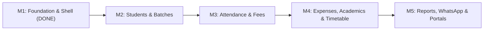

# TATIS — Tuition Administration & Tracking Information System

[](https://github.com)
[](https://www.typescriptlang.org/)
[](https://react.dev/)
[](https://tailwindcss.com/)
[](https://supabase.com/)

---

## 1. Project Overview

**TATIS** (Tuition Administration & Tracking Information System) is a modern, modular web application engineered to streamline and centralize the operational lifecycle of private tuition centres, coaching institutes, and educational academies.

TATIS replaces fragmented spreadsheets and ad-hoc communication with a single source of truth for:
- Student enrollment, parent directories, and academic records.
- Batch scheduling, classroom allocations, and tutor management.
- Multi-channel attendance compliance (biometric/barcode ready).
- Fee tracking, flexible installment structures, digital invoicing, and expense ledgers.
- Academic performance monitoring, test series scoring, and parent progress reporting.

For **Milestone 1 (M1)**, the technical foundation, design system, authentication engine, multi-tenant database schema, Row Level Security (RLS) policies, and responsive application shell are established.

---

## 2. Technology Stack

### Frontend Core
- **Framework**: [React 18](https://react.dev/) with [TypeScript 5.7](https://www.typescriptlang.org/)
- **Bundler & Tooling**: [Vite 6](https://vitejs.dev/)
- **Styling**: [Tailwind CSS 3.4](https://tailwindcss.com/) with CSS Custom Property semantic tokens
- **Component Primitives**: [shadcn/ui](https://ui.shadcn.com/) aesthetic built with `class-variance-authority` and `tailwind-merge`
- **Routing**: [React Router DOM v6](https://reactrouter.com/) (Browser router with nested route layouts & guards)
- **Icons**: [Lucide React](https://lucide.dev/)

### Backend & Data Infrastructure
- **Backend-as-a-Service**: [Supabase](https://supabase.com/)
- **Database Engine**: PostgreSQL 15+ with `uuid-ossp` and `pgcrypto`
- **Authentication**: Supabase Auth (Email/Password, OAuth session handling, password recovery)
- **Security**: Strict PostgreSQL Row Level Security (RLS) on all foundation tables
- **Storage**: Pre-configured Supabase Storage buckets architecture (`avatars`, `student-documents`, `receipts`, `reports`)

### State & Utilities
- **Server Cache & Async State**: [TanStack Query v5](https://tanstack.com/query/latest)
- **Client State**: [Zustand](https://github.com/pmndrs/zustand) with `localStorage` persistence (theme, active organization, auth session)
- **Forms & Validation**: [React Hook Form](https://react-hook-form.com/) + [Zod](https://zod.dev/)
- **Data Visualization**: [Recharts](https://recharts.org/)

### Testing & Code Quality
- **Unit Testing**: [Vitest](https://vitest.dev/) with [React Testing Library](https://testing-library.com/) and `jsdom`
- **Linter**: [ESLint 9](https://eslint.org/) (Flat Config with `typescript-eslint` and React Hooks rules)

---

## 3. Project Structure

```
tatis/
│
├── public/
│   ├── icons/
│   │   └── logo.svg                 # TATIS brand monogram logo
│   └── manifest.webmanifest         # PWA Web manifest
│
├── src/
│   ├── app/
│   │   ├── App.tsx                  # Root application entry with ErrorBoundary
│   │   ├── router.tsx               # Route definitions, guards & 404 handling
│   │   ├── providers.tsx            # QueryClient, theme init, auth state listener
│   │   └── guards/
│   │       ├── AuthGuard.tsx        # Protected route session gate
│   │       └── GuestGuard.tsx       # Auth route guest gate
│   │
│   ├── components/
│   │   ├── ui/                      # Button, Input, Card, Badge, Avatar, Skeleton
│   │   ├── layout/                  # AppShell, Sidebar, TopNavbar, Breadcrumbs, ThemeToggle, UserProfileMenu
│   │   ├── common/                  # StatCard, EmptyState, LoadingSpinner, ErrorBoundary, PageHeader, PlaceholderPage
│   │   ├── forms/                   # FormField, PasswordInput
│   │   └── feedback/                # Alert, ConfigBanner
│   │
│   ├── modules/
│   │   ├── auth/                    # Login, Register, ForgotPassword, ResetPassword, VerifyEmail, Callback
│   │   ├── dashboard/               # DashboardPage, SummaryCards, FeeCollectionChart, AttendanceOverview, etc.
│   │   ├── students/                # Students module placeholder (M2 Roadmap)
│   │   ├── batches/                 # Batches module placeholder (M2 Roadmap)
│   │   ├── fees/                    # Fees & Payments module placeholder (M3 Roadmap)
│   │   ├── expenses/                # Operating Expenses module placeholder (M4 Roadmap)
│   │   ├── attendance/              # Attendance module placeholder (M3 Roadmap)
│   │   ├── academics/               # Academics & Timetable module placeholders (M4 Roadmap)
│   │   ├── reports/                 # Reports module placeholder (M5 Roadmap)
│   │   ├── notifications/           # Notifications module placeholder (M5 Roadmap)
│   │   └── settings/                # Settings, Profile, Preferences, Account & Security
│   │
│   ├── services/
│   │   ├── supabase/                # client.ts, config.ts, storage.ts
│   │   └── auth/                    # authService.ts
│   │
│   ├── database/
│   │   └── types/                   # database.types.ts (strict typed database schema)
│   │
│   ├── hooks/                       # useAuth, useTheme, useOrganization
│   ├── lib/                         # utils.ts (cn helper)
│   ├── schemas/                     # auth.schema.ts (Zod validation schemas)
│   ├── store/                       # authStore.ts, themeStore.ts, organizationStore.ts
│   ├── utils/                       # formatters.ts (currency, dates, percent)
│   ├── styles/                      # tokens.ts (semantic brand color values)
│   │
│   ├── main.tsx                     # React DOM bootstrap
│   └── index.css                    # Tailwind directives & CSS theme tokens
│
├── supabase/
│   ├── migrations/
│   │   └── 20250101000000_foundation_schema.sql  # Complete M1 DDL, triggers & RLS
│   └── seed.sql                     # Seed template
│
├── tests/
│   ├── setup.ts                     # Testing library setup
│   └── unit/                        # Unit tests for schemas, utilities & components
│
├── .env.example                     # Environment variables template
├── .gitignore
├── package.json
├── tsconfig.json
├── vite.config.ts
├── tailwind.config.js
├── postcss.config.js
├── eslint.config.js
└── README.md
```

---

## 4. Visual Identity & Design System

The TATIS design system uses a restrained SaaS visual hierarchy:

| Token Category | Token Name | Hex Code | Purpose |
| :--- | :--- | :--- | :--- |
| **Primary** | Midnight Indigo | `#2D264B` | Primary action buttons, dark brand headers |
| | Deep Indigo | `#211C38` | Dark background accents, hovered primary elements |
| | Soft Indigo | `#766C9C` | Secondary actions, badges, muted borders |
| **Accent** | Neon Sky | `#4ADEDE` | High-contrast visual focus, indicators, charts |
| | Muted Cyan | `#B8F0ED` | Light accent fills, subtle badge backgrounds |
| **Background** | Light Background | `#F7F7FA` | Primary page canvas in light mode |
| | White | `#FFFFFF` | Card surfaces in light mode |
| | Dark Background | `#151421` | Canvas in dark mode |
| | Dark Surface | `#211F30` | Card & popover surfaces in dark mode |
| **Status** | Success | `#059669` | Paid status, present attendance, active accounts |
| | Warning | `#D97706` | Approaching due dates, partial payments |
| | Error | `#E11D48` | Overdue fees, absences, validation errors |
| | Information | `#2563EB` | System notices, schedule shifts |

### Theme Support
- **Modes**: Light, Dark, System Preference.
- **Persistence**: Saved in `localStorage` under `tatis-theme-preference` and synced to `document.documentElement` class list.
- **Components**: Fully theme-aware using CSS custom properties (`hsl(var(--primary))`, etc.).

---

## 5. Installation & Local Development

### Prerequisites
- Node.js `v18.0.0` or later (`v24+` tested)
- npm or pnpm

### Setup Steps

1. **Clone the repository and enter directory**:
   ```bash
   git clone https://github.com/your-org/tatis.git
   cd tatis
   ```

2. **Install dependencies**:
   ```bash
   npm install
   ```

3. **Configure environment variables**:
   Copy `.env.example` to `.env`:
   ```bash
   cp .env.example .env
   ```

4. **Start the development server**:
   ```bash
   npm run dev
   ```
   Open [http://localhost:5173](http://localhost:5173) in your browser.

---

## 6. Supabase Setup & Database Migrations

### Step 1: Create a Supabase Project
1. Log into your [Supabase Dashboard](https://supabase.com).
2. Click **New Project**, choose a region and set a database password.

### Step 2: Execute Schema Migration
1. In the Supabase Dashboard, open the **SQL Editor** from the left navigation.
2. Open the file [supabase/migrations/20250101000000_foundation_schema.sql](file:///c:/Users/Atharva%20Pawar/Documents/Projects/TATIS/supabase/migrations/20250101000000_foundation_schema.sql).
3. Paste its contents into the SQL Editor and click **Run**.
4. The migration will create:
   - `profiles` table (linked to `auth.users`)
   - `organizations` table (with owner reference)
   - `organization_members` table (with roles: `owner`, `admin`, `teacher`, `staff`)
   - `app_settings` table (organization-scoped JSON settings)
   - `user_preferences` table (theme, timezone, language, notifications)
   - `audit_logs` table (tenant-scoped audit trail)
   - `update_updated_at_column()` trigger function
   - `on_auth_user_created` trigger on `auth.users` that automatically creates a profile, organization, and owner membership upon signup
   - Complete Row Level Security (RLS) policies isolating tenant data

### Step 3: Configure Local Environment
1. In Supabase, navigate to **Project Settings** → **API**.
2. Copy your **Project URL** and **Project API Key (anon/public)**.
3. Paste them into your `.env` file:
   ```env
   VITE_SUPABASE_URL=https://your-project-id.supabase.co
   VITE_SUPABASE_ANON_KEY=eyJhbGciOiJIUzI1NiIsInR5cCI6IkpXVCJ9...
   VITE_APP_ENV=development
   ```
4. Restart your Vite dev server (`npm run dev`). TATIS will immediately detect the live Supabase credentials and clear the configuration helper banner.

---

## 7. Development & Quality Commands

| Command | Purpose |
| :--- | :--- |
| `npm run dev` | Starts Vite local development server with Hot Module Replacement |
| `npm run typecheck` | Executes strict TypeScript compilation verification (`tsc --noEmit`) |
| `npm run lint` | Runs ESLint 9 across all source and test files |
| `npm run test` | Runs all Vitest unit tests |
| `npm run test:watch` | Runs Vitest in interactive watch mode |
| `npm run build` | Runs TypeScript compilation and builds optimized production bundle in `dist/` |
| `npm run preview` | Locally serves the production `dist/` build |

---

## 8. Milestone 1 Acceptance Status

- [x] **React + TypeScript + Vite**: Configured with strict compiler rules and alias `@/`.
- [x] **Modular Architecture**: Module-based directory structure (`auth`, `dashboard`, `students`, `batches`, `fees`, etc.).
- [x] **Design System & Semantic Tokens**: Implemented with Midnight Indigo, Soft Indigo, and Neon Sky palette.
- [x] **Theme Switcher**: Supports Light, Dark, and System modes with instant live switching and persistence.
- [x] **Application Shell**: Responsive desktop sidebar (collapsible with tooltips), mobile drawer, breadcrumbs, search shortcut, and user menu.
- [x] **Dashboard Foundation**: 6 summary cards, Recharts fee collection chart, attendance breakdown, upcoming classes, reminders, and recent activity with demo-mode toggle.
- [x] **Authentication Pages**: Login, Register, Forgot Password, Reset Password, Email Verification, and Auth Callback.
- [x] **Supabase Authentication**: Integrated via `authService.ts` with persistent sessions and auth guards.
- [x] **Database Migrations & RLS**: Migration DDL created with automatic profile creation trigger and cross-tenant isolation.
- [x] **Organization Architecture**: Multi-tenant database foundation and client store established.
- [x] **Environment Configuration**: Safe client-only key handling, `.env.example`, and configuration helper banner.
- [x] **Validation & Tests**: 13 unit tests passing, TypeScript clean (0 errors), ESLint clean (0 errors/warnings), production build successful.

---

## 9. Roadmap



- **Milestone 2 (M2)**: Student Onboarding, Academic Profiles, Guardian Contacts, Batch Creation & Capacity Management.
- **Milestone 3 (M3)**: Daily Attendance Register, Fee Structures, Invoicing Engine, Online Payments & Receipts.
- **Milestone 4 (M4)**: Centre Operational Expenses, Tutor Payouts, Syllabus Tracker, Test Series & Interactive Timetable.
- **Milestone 5 (M5)**: Advanced Financial Reports, WhatsApp/SMS Communication Engine, Multi-Branch Federation, Student/Parent Mobile Portal.

---

## 10. Security & Best Practices

1. **Service Role Keys**: The Supabase service-role secret key is strictly excluded from client-side code and configuration. Only the public `anon` key is used.
2. **Row Level Security**: Every table enforces PostgreSQL RLS. Users can only access records matching their verified organization membership or user ID.
3. **Session Persistence**: JWT sessions are stored and refreshed automatically via Supabase Auth without plaintext password storage.
4. **Input Sanitization**: Form inputs are validated through Zod schemas before API dispatch.
